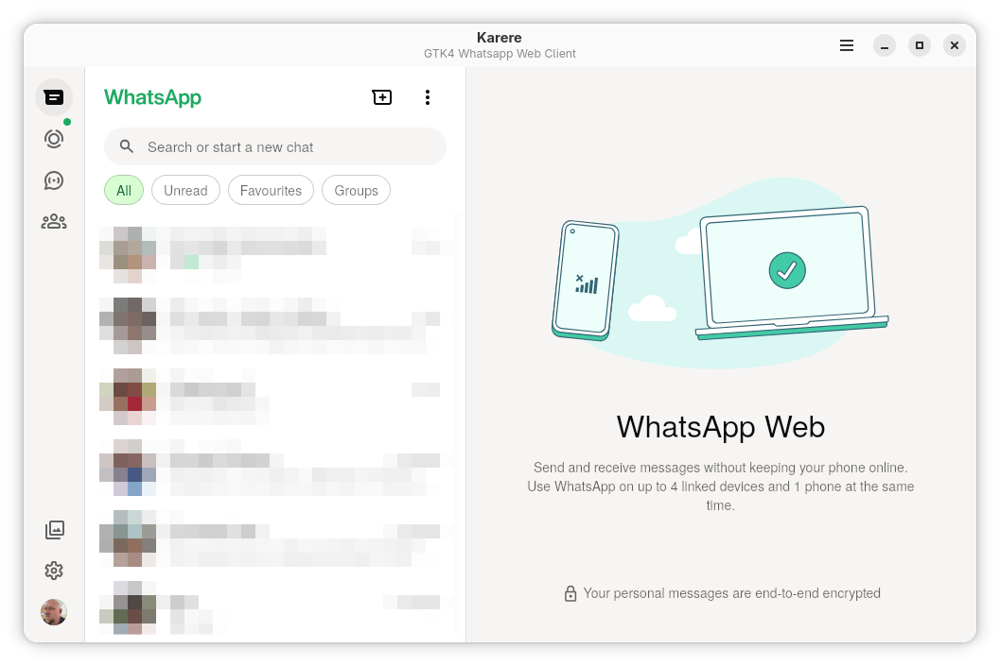
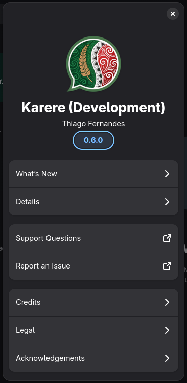
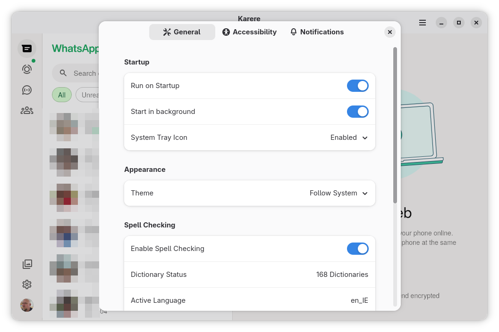
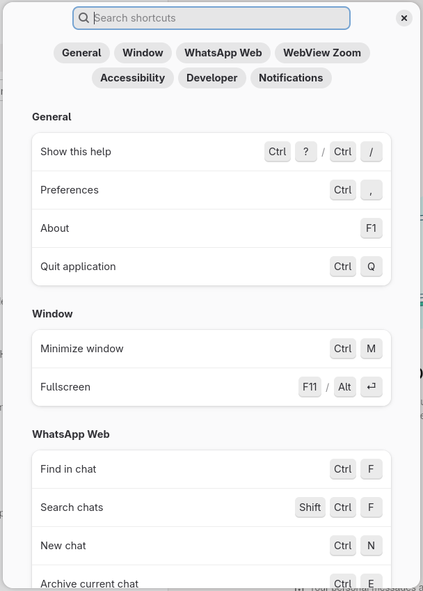

# Karere

A fast, native WhatsApp client for Linux that feels right at home on your desktop.

<div align="center">



<a href="https://flathub.org/en/apps/io.github.tobagin.karere"></a>
<a href="https://ko-fi.com/tobagin"></a>

</div>

## 🎉 Version 4.4 — CEF/Chromium 156

**Karere 4.0** is a ground-up rewrite that swaps the rendering backend from WebKitGTK to the
**Chromium Embedded Framework (CEF/Chromium 156)** while keeping the same native
GTK4/libadwaita shell. It is a **hard fork** of Karere v3: there is **no automatic migration**
— existing accounts must be re-linked by scanning the QR code again on first launch.

### Why CEF?

WebKitGTK could not play WhatsApp Web's video attachments (a platform-level limitation shared
by all WebKitGTK browsers). Chromium handles them natively. The CEF build ships with
proprietary codecs (H.264/AAC), so **video attachments now play in-app**.

### 🆕 What's New in 4.4.1

- **Run on Startup message (#206)**: on desktops without a Background portal, such as Cinnamon
  on Linux Mint 21, Karere now explains how to add it to the startup applications with
  `--background` instead of pointing at a system setting that does not exist there.

> **Migration from v3.** None. v3 stored sessions under WebKit's data manager; v4 uses CEF
> `RequestContext` directories and a new account record format. On first v4 launch, re-scan the
> QR code for each account.

For the full release history, see [CHANGELOG.md](CHANGELOG.md).

## Features

### Core Features
- **Native Experience**: Designed to look and feel like a native application on your desktop.
- **System Integration**: Notifications, themes, and shortcuts work exactly as you expect.
- **Privacy Focused**: Sandboxed communication with comprehensive privacy controls.
- **Efficient**: Optimized to be lightweight and fast.
### User Experience
- **System Tray Icon**: Dynamic icon showing unread status, with background run support
- **Notification Sounds**: Plays WhatsApp Web's own notification sound for new messages, with an on/off toggle
- **Image & Text Paste**: Seamless Ctrl+V support for both mixed content types
- **Download Manager**: Custom directory selection (e.g., `~/Downloads`) with toast notifications

### Accessibility
- **Screen Reader Support (partial)**: The GTK interface is fully labeled. Inside WhatsApp, the
  screen reader announces each control and message as keyboard focus moves to it. Browse mode and
  reviewing the page without moving focus are not supported yet.
- **Keyboard Navigation**: Use the entire app without a mouse.
- **Visual Aids**: Zoom controls and reduced motion.
- **Auto-Correct**: Automatic text replacement, which can be turned off in Preferences

### Spell Checking
- **Multi-Language Support**: 52 languages from Chromium's spellcheck dictionaries (the list is `KNOWN_LANGUAGES` in `src/spellcheck.rs`)
- **Auto-Detection**: Smart language detection based on system locale
- **Dictionary Management**: Override auto-detect to select specific languages
- **Auto-Correct Toggle**: Enable or disable automatic text replacement

### Privacy & Customization
- **Granular Notification Controls**: Master toggle, plus individual settings for sound on/off, previews, and downloads
- **Privacy Settings**: Control message previews and system tray behavior
- **Theme Selection**: Light, Dark, or System preference
- **Permission Management**: Persistent controls for Microphone and Notifications
- **Startup Control**: Toggle automatic launch on login

## Building from Source

```bash
# Clone the repository
git clone https://github.com/tobagin/karere.git
cd karere

# Build and install development version
./build.sh --dev
flatpak run io.github.tobagin.karere.Devel
```

`./build.sh --dev` builds the working tree via `packaging/io.github.tobagin.karere.Devel.yml` (`-Dprofile=development`); plain `./build.sh` builds the production manifest (`packaging/io.github.tobagin.karere.yml`, pinned to the latest release tag) — not the checkout. After any `Cargo.toml`/`Cargo.lock` change run `./build.sh --regen-sources` (or `--dev --regen-sources`) to refresh vendored sources.

**Build dependency**: the UI is authored in [Blueprint](https://gnome.pages.gitlab.gnome.org/blueprint-compiler/) (`data/ui/*.blp`, including `preferences.blp` and `keyboard-shortcuts.blp`) and compiled to `.ui` at build time. `blueprint-compiler` must be on `PATH` for a local `cargo build`; the Flatpak SDK (`org.gnome.Sdk//51`) already ships it, so the Flatpak build needs no manifest change.

**Running outside Flatpak**: a local `cargo run` enables Chromium's own sandbox (it is only disabled inside the Flatpak sandbox). This requires unprivileged user namespaces; on kernels or distributions that disable them, CEF will refuse to start. Enable them with `sysctl kernel.unprivileged_userns_clone=1` (Debian-style) or `sysctl user.max_user_namespaces=10000` (some hardened configs). Non-Flatpak packaging remains unsupported.

**Note**: After installation, you'll need to scan the QR code with your mobile WhatsApp to connect.

## Usage

### Basic Usage

Launch Karere from your applications menu or run:
```bash
flatpak run io.github.tobagin.karere
```

The application will load WhatsApp Web and provide native desktop integration.

### Preferences

Access preferences through the application menu or keyboard shortcut (`Ctrl+,`) to configure:

- **General**: Theme selection, developer tools
- **Accessibility**: Keyboard shortcuts, focus indicators, reduced motion, zoom settings, screen reader optimization
- **Notifications**: Native notification preferences, preview settings, background notifications
- **Spell Checking**: Multi-language spell checking with auto-detect

### Keyboard Shortcuts

#### Standard
- `Ctrl+Q` - Quit Application
- `Ctrl+,` - Open Preferences
- `Ctrl+?` - Show Keyboard Shortcuts
- `Ctrl+W` - Close window
- `Ctrl+M` - Minimize window
- `F11` or `Alt+Enter` - Toggle fullscreen
- `Ctrl+Tab` or `Ctrl+Page_Down` - Next account
- `Ctrl+Shift+Tab` or `Ctrl+Page_Up` - Previous account
- `Alt+1` to `Alt+9` - Switch to account 1 to 9

#### Zoom
- `Ctrl++` (also `Ctrl+=` and keypad `+`) - Zoom In
- `Ctrl+-` (also keypad `-`) - Zoom Out
- `Ctrl+0` (also keypad `0`) - Reset Zoom

#### Developer
- `F12` or `Ctrl+Shift+I` - Open Developer Tools
- `Ctrl+Shift+C` - Inspect element

#### WhatsApp Web
- `Ctrl+R` or `F5` - Reload page
- `Ctrl+Shift+R` - Reload, bypassing the cache
- `Ctrl+F` - Find in page

### Accessibility Features

Karere includes comprehensive accessibility support:

- **Screen Reader Support (partial)**: Focus changes inside WhatsApp are announced (turned on
  automatically when a screen reader is running); browse mode is not supported yet
- **Keyboard Navigation**: Accounts, zoom, reload and find have shortcuts (see Keyboard Shortcuts above)
- **Reduced Motion**: Can be turned on in Preferences

## Architecture

Karere is built using modern GNOME technologies:

- **Rust**: Primary programming language for memory safety and performance
- **GTK4**: Modern toolkit with excellent Wayland support
- **LibAdwaita**: Native GNOME design language and components
- **CEF / Chromium 156**: Chromium Embedded Framework renders WhatsApp Web (off-screen, composited into a GTK `GLArea`)
- **Blueprint**: Declarative UI definition language
- **Flatpak**: Secure application distribution

Each account runs in its own CEF `RequestContext`. An account's name and avatar are read from the
data WhatsApp Web keeps in the page's localStorage and IndexedDB (see `data/js/60-store-hook.js`),
not from WhatsApp's internal Store. Existing v3 accounts must be linked again on first v4 launch.

## Privacy & Security

Karere is designed with privacy in mind:

- **Sandboxed**: Runs in a Flatpak sandbox with minimal permissions
- **Local Storage**: Uses standard user data directories, no external services
- **Transparent**: Open source code available for audit

## Known Limitations

### Video Attachments
**Video attachments now play in-app.** The v4 CEF/Chromium 156 backend ships with proprietary
codecs (H.264/AAC), removing the WebKitGTK platform limitation that blocked video playback in
v3 and earlier.

### Voice & Video Calls
**Calling requires WhatsApp Web's beta program.** Voice and video calls are still a beta feature
on WhatsApp Web itself — the call buttons only appear once your account is enrolled in the
**WhatsApp Web beta**. Karere provides the codecs and permissions plumbing (microphone/camera
prompts, H.264/AAC), but it cannot surface call controls that WhatsApp Web does not expose. To
enable them, join the beta from the official WhatsApp client (Settings on your phone, or the
WhatsApp Web beta opt-in); calls then work in Karere like any other WhatsApp Web feature.

## Contributing

Contributions are welcome! Please see [CONTRIBUTING.md](CONTRIBUTING.md) for guidelines on:

- Setting up your development environment
- Code style and conventions
- Testing and building
- Submitting pull requests
- Reporting bugs and feature requests

For questions or discussions, please use [GitHub Discussions](https://github.com/tobagin/karere/discussions).

## License

Karere is licensed under the GNU General Public License v3.0 or later. See [LICENSE](LICENSE) for the full license text.

## Support

- **Discussions**: Use [GitHub Discussions](https://github.com/tobagin/karere/discussions) for questions
- **Issues**: Use [GitHub Issues](https://github.com/tobagin/karere/issues) for bugs and feature requests

## Acknowledgments

- **GNOME Project**: For the excellent GTK4 and LibAdwaita frameworks
- **Chromium / CEF Project**: For the Chromium Embedded Framework rendering engine
- **Rust Community**: For the amazing language and tools
- **WhatsApp Inc.**: For WhatsApp Web

## Screenshots

| Main Window | About Dialog |
|-------------|--------------|
|  |  |

| Preferences | Shortcuts |
|-------------|-----------|
|  |  |

---

**Karere** - Native WhatsApp Web client for Linux desktop environments.
